# Agent workflow

One **decision cycle** runs per closed bar per symbol (bar interval is a strategy parameter; built from verified 1m
bars). Three **independent loops** run beside it and never wait for the model or a human.

## 1. Decision cycle state machine

```mermaid
stateDiagram-v2
  [*] --> REFRESH_DATA: bar closed (clock)
  REFRESH_DATA --> VALIDATE_DATA
  VALIDATE_DATA --> JOURNAL: unusable (stale / gap / not eligible) → DATA_UNUSABLE
  VALIDATE_DATA --> BUILD_CONTEXT
  BUILD_CONTEXT --> GENERATE_CANDIDATES: snapshot + features + regime
  GENERATE_CANDIDATES --> REVIEW_OPEN_POSITIONS
  REVIEW_OPEN_POSITIONS --> JOURNAL: no candidates and no position under review → NO_CANDIDATES (no LLM call)
  REVIEW_OPEN_POSITIONS --> AI_REASONING
  AI_REASONING --> VALIDATE_DECISION: AgentDecision | timeout | error
  VALIDATE_DECISION --> JOURNAL: WAIT (chosen or fallback) → WAITED
  VALIDATE_DECISION --> BUILD_INTENT: ENTER / EXIT_POSITION valid
  BUILD_INTENT --> PERMISSION_CHECK
  PERMISSION_CHECK --> JOURNAL: PROPOSE_ONLY → PROPOSED
  PERMISSION_CHECK --> JOURNAL: BLOCKED
  PERMISSION_CHECK --> RISK_REVIEW: REQUIRE_APPROVAL / EXECUTE
  RISK_REVIEW --> JOURNAL: REJECT → RISK_REJECTED
  RISK_REVIEW --> AWAIT_APPROVAL: approve/reduce + REQUIRE_APPROVAL
  RISK_REVIEW --> EXECUTE: approve/reduce + EXECUTE
  AWAIT_APPROVAL --> JOURNAL: ticket opened → AWAITING_APPROVAL (cycle ends; ticket resolved asynchronously)
  EXECUTE --> RECONCILE: ACK | UNKNOWN
  RECONCILE --> ARM_EXITS: filled / partial (protect filled qty immediately)
  RECONCILE --> JOURNAL: rejected / unresolved → EXECUTION_FAILED / EXECUTION_UNKNOWN
  ARM_EXITS --> JOURNAL: SUBMITTED / FILLED / PARTIALLY_FILLED
  JOURNAL --> [*]
```

Approval continuation (separate trigger, `wallex-agent approve TICKET`):
`CONSUME_TICKET → RISK_REVIEW (fresh data, fresh balances) → EXECUTE → RECONCILE → ARM_EXITS → JOURNAL`.
Expired/rejected tickets → `APPROVAL_EXPIRED` / `APPROVAL_REJECTED`. The original decision record is linked.

### Stage contracts

| Stage | Input → output | Deterministic? | Notes |
|---|---|---|---|
| REFRESH_DATA | symbol, `as_of` → raw bars, book, meta | yes (I/O) | REST candles from 1m; WS/REST book; payload `s` checked, not just transport status |
| VALIDATE_DATA | raw → quality flags | yes | Drop the forming bar; detect spacing ≠ requested; crossed/one-sided book; age limits |
| BUILD_CONTEXT | → `MarketSnapshot`, `FeatureSet` | yes | Content-hashed; only bars closed ≤ `as_of` |
| GENERATE_CANDIDATES | → `SignalCandidate[]` | yes | Each strategy versioned; exits fixed; candidate TTL |
| REVIEW_OPEN_POSITIONS | positions → review list | yes | Only if `agent.allow_exit_position`; protective exits are NOT here (exit watcher) |
| AI_REASONING | snapshot, features, candidates, positions → `AgentDecision` | **AI** | Bounded (below) |
| VALIDATE_DECISION | → `ValidatedDecision` | yes | Any failure → WAIT with `ValidationStatus` |
| BUILD_INTENT | candidate + sizer → `OrderIntent` | yes | `client_order_id` and `intent_hash` created here |
| PERMISSION_CHECK | autonomy × action → `PolicyOutcome` | yes | `policy/permissions.py` |
| RISK_REVIEW | intent + ledger + fresh data → `RiskVerdict` | yes | Reserve on approve; short verdict TTL |
| AWAIT_APPROVAL | → `ApprovalTicket` | yes | Non-blocking: the cycle ends |
| EXECUTE | intent + verdict → `ExecutionEvent` | yes (I/O) | Persist INTENT before send; no blind retry |
| RECONCILE | → order state, fills, fees | yes (I/O) | UNKNOWN resolved by `client_order_id` lookup |
| ARM_EXITS | fills → exit plan registered | yes | Exit coordinator owns all exits for a position |
| JOURNAL | → `DecisionRecord` | yes | Always written, success or not |

## 2. Bounds (no unbounded agent loops)

| Bound | Mechanism | Config key |
|---|---|---|
| One reasoning run per symbol per bar | orchestrator schedules; no re-entry while a run is in flight | — |
| Model requests per run | PydanticAI `UsageLimits.request_limit` | `agent.max_model_requests` |
| Tool calls per run | `UsageLimits.tool_calls_limit` + Tool Gateway budget | `agent.max_tool_calls` |
| Wall-clock deadline | `asyncio.timeout` around the run; late output = STALE | `agent.decision_deadline_s` |
| Output retries | agent `retries` small; validation failure after that → WAIT | `agent.output_retries` |
| Tool error handling | `tool_error_behavior` ≠ `retry` for MCP tools | — |
| Cost | optional `UsageLimits.cost_limit` per run and a daily budget | `agent.cost_limit` |
| Assistant | same limits, separate budget; never runs inside a trading cycle | `assistant.*` |

No agent spawns agents. No reflection/self-critique loops. If a second opinion is ever added, it is a bounded,
journaled step with its own ablation, not an open loop.

## 3. Independent loops

| Loop | Cadence | Does | Depends on AI/human? |
|---|---|---|---|
| **Exit watcher** | fast (book/trade updates or seconds) | Stop / TP / time exits from each position's fixed plan; partial-fill protection | **No** |
| **Reconciler** | periodic + on startup + after UNKNOWN | Compare ledger with Wallex open orders, order-by-client-id, balances; raise mismatch → kill trigger | No |
| **Cutoff scheduler** | official clock (U01) | No-new-entry window → cancel entries → liquidate all non-TMN to TMN → verify fills → report dust | No |
| Health monitor | seconds | Feed age, error streaks, rate limit, breakers, kill triggers | No |

## 4. Failure handling

| Failure | Response |
|---|---|
| Data stale / gap / crossed book | No new entry on that symbol (`DATA_UNUSABLE`); exits use last valid book with escalation |
| MCP `isError=false` but payload error (observed: `Invalid resolution!`) | Treated as error by the adapter; never parsed as data |
| LLM timeout / provider error / invalid output | WAIT; AI breaker after streak; journaled with status |
| Risk reject | Journaled with failed checks; no retry with a "different size" by the AI |
| Approval expired | Ticket EXPIRED; nothing sent; a new cycle may create a new intent |
| Submit timeout / lost response | State UNKNOWN → reconcile by `client_order_id`; no resubmit until resolved |
| Partial fill | Protect filled qty immediately; residual entry cancelled on TTL; reconcile after cancel (fill-after-cancel race) |
| Market order rejected (book thin / >2% move rule in docs) | Exit escalation ladder: limit at best bid with short TTL → reprice within slippage budget → kill if exhausted |
| Restart | Load ledger + open intents → reconcile all non-terminal orders → re-arm exits → only then resume cycles |
| Rate limited | Defer non-essential reads; exits first |
| Clock/cutoff unknown | LIVE refuses to start without official end time configured |

## 5. Cycle examples (expected journal outcomes)

- Quiet market, no breakout → `NO_CANDIDATES`, no model call.
- Two candidates, model picks BTCTMN breakout, ADVISOR → `PROPOSED` with intent and verdict preview.
- Same in APPROVAL_REQUIRED → `AWAITING_APPROVAL`; operator approves within TTL → fresh risk → `FILLED`.
- Same in AUTONOMOUS/SHADOW → `FILLED` (simulated), exits armed; stop hit later by the exit watcher, journaled
  as an exit event linked to the entry decision.
- Model returns a candidate id it was not given → `UNKNOWN_REFERENCE` → `WAITED`.
