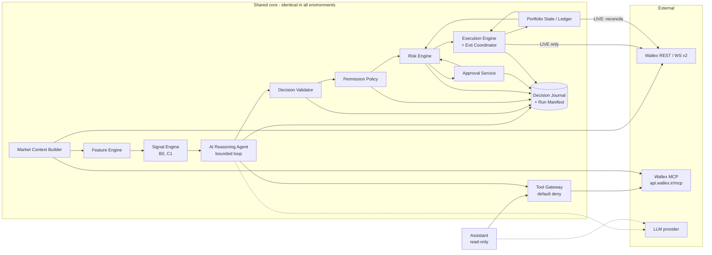

# Architecture

Status: Phase 02 design, accepted; **implemented in Phase 03** (BACKTEST and SHADOW end to end, LIVE adapter and
preflight on fakes only). Implementation-forced changes are listed in §11; the design itself did not change.

Source of truth for rules: `research/phase-01/evidence/BRIEF_PROVIDED_FA.md` (official brief) and Wallex official
docs/MCP (`developers.wallex.ir`, `api.wallex.ir/llm.txt`). Decisions: `docs/adr/`.

## 1. Shape in one paragraph

A **deterministic trading kernel** (data → features → candidates → risk → execution → ledger → exits) with a
**bounded AI agent** placed at the one point where judgement adds value: choosing which deterministic candidate, if
any, to take, given market context it can investigate through read-only tools. The same kernel, agent, policy and
journal run in BACKTEST, SHADOW and LIVE; only the adapters behind four ports change. An **assistant** answers
operator questions from the same tools and the decision journal, and never writes.



## 2. Components

| Component | Kind | Responsibility | Package |
|---|---|---|---|
| Orchestrator | deterministic | Cycle state machine, schedulers (exit watcher, reconciler, cutoff), composition root | `runtime` |
| Market Context Builder | deterministic + external | Fetch, QC (spacing, gaps, incomplete bar, crossed/one-sided book, staleness), eligible universe, `MarketSnapshot` with content hash | `market` |
| Feature Engine | deterministic | Pure features from closed bars + book; rule-based regime label | `features` |
| Signal Engine | deterministic | Versioned candidate generators (B0 rule baseline, C1 breakout); fixed exits per candidate | `strategies` |
| **AI Reasoning Agent** | **AI-driven, bounded** | Investigate context with read tools; output `AgentDecision` (select / WAIT / early exit) | `agent` |
| **Assistant** | **AI-driven, read-only** | Natural-language Q&A over market, portfolio, risk and journal; counterfactual "what would autonomous do" | `agent` |
| Tool Gateway | deterministic | Catalog, per-consumer/per-environment exposure, call budget, audit and recording of every call | `tools` |
| Decision Validator | deterministic | Schema + reference + TTL checks; every failure → WAIT | `agent` (validator) |
| Permission Policy | deterministic | Autonomy × action → PROPOSE_ONLY / REQUIRE_APPROVAL / EXECUTE / BLOCKED | `policy` |
| Risk Engine | deterministic | Checks, sizing, reservations, protections, kill latch, breakers | `risk` |
| Approval Service | deterministic | Single-use tickets bound to intent hash; CLI approve/reject | `approval` |
| Execution Engine | deterministic + external | Order state machine, idempotent client ids, UNKNOWN→reconcile, exit coordinator | `execution` |
| Portfolio State / Ledger | deterministic | Net fills after fees, reservations, equity, HWM, reconciliation | `portfolio` |
| Decision Journal | deterministic | Append-only records, run manifest, recorded model/tool payloads | `journal` |
| Wallex adapters | external | REST public/private, WS v2 (book), MCP client | `market`, `execution`, `portfolio` |
| LLM provider | external | Inference via PydanticAI (provider-agnostic) | `agent` |

AI-driven parts are exactly two, both bounded. Everything that sizes, approves, sends, cancels, exits or books is
deterministic.

## 3. Why this is genuinely agentic (and not "one LLM call → BUY/SELL")

| Agentic property | Where it lives |
|---|---|
| **State** | Snapshot, features, candidates, open positions, risk status, recent decisions are given to the agent as tools/context; workflow state persists across cycles in the journal/ledger |
| **Tools** | Internal read tools (`get_candidates`, `get_features`, `get_position`, `get_risk_status`, `get_recent_decisions`) + Wallex MCP public reads (`candle_history`, `market_depth`, `latest_trades`) in SHADOW/LIVE |
| **Structured actions** | `AgentDecision` (typed, versioned, validated) — the only output the trading path accepts |
| **Multi-step workflow** | Agent may drill down (e.g. check depth for the selected symbol, compare a longer window) before deciding, capped by `UsageLimits` |
| **Explicit permissions** | `exposed_tools(consumer, environment)`, default deny, tested invariants |
| **Auditable** | Every model request, tool call (args/result hash + stored payload) and decision is journaled |
| **Deterministic boundary** | ADR-002 path; risk engine cannot be overridden |

The LLM is invoked only when there is something to decide (≥1 valid candidate, or an open position under review),
not on every tick. That bounds cost and makes each call meaningful.

## 4. Three kinds of state, three owners

| State | Owner | Never stored in |
|---|---|---|
| Model conversation (messages, tool calls) | PydanticAI run, persisted to journal for audit/replay | ledger |
| Workflow (cycle stage, approval tickets, kill latch, breaker state) | Orchestrator + SQLite | model memory |
| Trade truth (orders, fills, balances, reservations, P&L) | Ledger, reconciled with Wallex | framework checkpoints, MCP session |

## 5. One system, three environments

Environment is selected **only** by which adapters the composition root constructs (`ports.py`):

| Port | BACKTEST | SHADOW | LIVE |
|---|---|---|---|
| `Clock` | virtual, bar-driven | wall | wall |
| `MarketDataPort` | recorded dataset (hash-pinned) | Wallex REST/WS + MCP reads | same as SHADOW |
| `AccountPort` | virtual ledger | virtual ledger (+ real fee rates read-only) | Wallex private reads |
| `ExecutionPort` | bar fill simulator (next-bar, conservative stop/TP order, fees, slippage stress) | book-based simulator (visible depth, latency, partial fills) | Wallex REST orders |
| `DecisionProvider` | LLM, recorded replay, or B0 baseline | LLM or B0 | LLM or B0 |
| Wallex tools for LLM | **none** (live data would leak the present into the past) | 3 public reads | 3 public reads |

Guards beyond wiring: the live adapter is never constructed outside LIVE; `ExecutionPort.submit` rejects an intent
whose `environment` differs from its own; `EXECUTION_ENGINE` tool exposure is empty outside LIVE.

Autonomy mode is the orthogonal second dimension (see `docs/AUTONOMY_AND_PERMISSIONS.md`). All 9 combinations are
valid; LIVE+AUTONOMOUS additionally requires the explicit operator gate.

## 6. The assistant

`wallex-agent ask "<question>"` runs the assistant agent with read-only tools:

| Question | Tools it uses |
|---|---|
| وضعیت بازار چیست؟ | `get_market_overview` (snapshots/features of the universe), MCP `market_depth`/`latest_trades` |
| چرا این معامله را پیشنهاد دادی؟ | `get_decision(decision_id)` → journal record: candidates, AI rationale, evidence ids, risk checks |
| الان چرا معامله نمی‌کنی؟ | `get_recent_decisions(n)` + `get_risk_status()` → WAIT reasons, breakers, kill latch, missing candidates |
| اگر حالت خودکار روشن بود چه می‌کردی؟ | `simulate_cycle(autonomy=AUTONOMOUS)` → runs validator→policy→risk with a null execution sink; returns the would-be intent and verdict, journaled as counterfactual |
| وضعیت ریسک حساب چیست؟ | `get_risk_status()` → equity, HWM, drawdown, exposure, budgets used, breakers |
| معاملات اخیر چرا انجام شدند؟ | `get_trades(since)` joined to decision records |

The assistant answers from journal facts; it cannot approve, execute, change mode, or reset the kill switch.
Approvals are a separate CLI command, so a chat answer can never become an order.

## 7. Reproducibility and decision logging

- `RunManifest` at run start: git commit (LIVE refuses a dirty tree), config hash, limits version, prompt bundle
  hash, model id + settings hash, `uv.lock` hash, universe version, dataset refs, clock mode, seed.
- `DecisionRecord` for every cycle that reached a decision, including WAIT/failed/blocked — schema in
  `docs/DATA_CONTRACTS.md`.
- **Replay** (`wallex-agent replay RUN_ID`): recorded snapshots + recorded model outputs + recorded tool results +
  virtual clock → same intents, verdicts and simulated fills, no network. **Rerun** (fresh inference) is a different
  thing and labelled as such.
- Delivered GitHub source = traded source: the LIVE run's commit is in its manifest; release tag points at it.

## 8. Validation against the scoring criteria

Brief table (labelled "proposed"; weights U03): 150 trading + 150 technical.

| Criterion (points) | How the architecture addresses it | Where | Residual risk |
|---|---|---|---|
| Profit potential (90) | C1 breakout candidates with cost-aware filters; AI arbitration chooses/declines; TMN-flat liquidation so profit is realized | `strategies`, `agent`, `execution` cutoff | No edge proven yet; only backtest/shadow can show it |
| Drawdown control (30) | Mark-to-liquidation equity + HWM, pause/emergency thresholds, per-trade budget sizing, exposure caps, loss-streak cooldown, kill latch | `risk`, `portfolio` | Thresholds not yet chosen (owner + evidence) |
| Activity (15) | Signal-driven cycles on closed bars across 1–2 liquid TMN symbols; journal shows regular evaluation even when waiting. No artificial trades | `runtime`, `strategies` | Over-strict filters could mean few trades; measured in shadow |
| Runtime stability (15) | Persist-before-send, UNKNOWN→reconcile, restart recovery (ADR-003), independent exit watcher, rate-limit breaker, AI failure → WAIT | `execution`, `runtime`, `recovery` | Host network/LLM access (U11) |
| Strategy logic (40) | Explicit, versioned, falsifiable hypotheses (B0/C1) with fixed exits; documented entry/exit rules | `strategies`, docs | — |
| Genuine AI use (35) | AI is the selector: no entry happens unless the model chose it; ablation A1 vs B0 on same data; assistant explains from facts | `agent`, journal | Judges' acceptance bar unknown |
| Risk management (30) | ADR-002 boundary; risk engine sizing/caps/stops; AI cannot widen risk | `risk`, `policy` | — |
| Reproducibility (25) | Manifest, journal, replay without network, pinned deps, run guide | `journal`, README | — |
| Backtest / shadow (20) | Same pipeline in all environments; separate reports with explicit fill assumptions and stress | `ports`, adapters | Historical depth coverage (U08) |

Decision logging and repeatability are satisfied structurally: every cycle produces a `DecisionRecord` linked to
data refs and versions, and replay consumes only recorded artefacts.

## 9. Repository layout

```
src/wallex_agent/
  contracts/   versioned data contracts (implemented)
  policy/      permission policy (implemented)
  tools/       Wallex tool catalog + exposure (implemented); gateway wrapper (Phase 03)
  ports.py     environment ports (implemented as Protocols)
  market/ features/ strategies/ agent/ risk/ approval/ execution/ portfolio/ journal/ reporting/ runtime/  (Phase 03)
  interface/   CLI: backtest, shadow, status, approve/reject, kill/reset-kill, replay, ask, preflight, drills, eval
tests/         Layer 1 (deterministic) + Layer 2 (replay) suites; Layer 3 NineRouter eval opt-in (`-m ninerouter`)
scripts/       inspect_wallex_mcp.py (public, read-only drift check)
docs/          architecture, workflow, permissions, contracts, tool map, OSS decisions, ADRs
research/      Phase 01/02 evidence (source of truth inputs)
reports/       owner reports and handoffs per phase
```

## 10. Open items affecting architecture

U01 official start/end clock · U02 realized-TMN vs mark-to-market and dust · U03 final weights · **U04 MCP/automatic
write confirmation** · U05 key scope · U06 real fees/precision · U07 package warning/liquidity trigger semantics ·
U08 history depth · U09 native stop/OCO behaviour · U10 platform auto-sell vs cutoff · U11 host/LLM access.
Full list and effects: `research/phase-01/WALLEX_CHALLENGE_AND_CAPABILITIES_FA.md`; Phase 03 view:
`reports/phase-02/HANDOFF_TO_PHASE_03.md`.

## 11. Phase 03 implementation notes (accepted changes)

- **Real model path:** the owner's local NineRouter (OpenAI-compatible) through PydanticAI's OpenAI provider, with
  streaming requests (non-streamed `av/*` responses are empty). The responding model is journaled (combo ids reroute).
- **Synchronous ports.** The orchestrator is synchronous at bar cadence; the LLM provider runs its async loop inside.
- **Risk engine produces the executable intent.** It receives an `IntentDraft` (decision + candidate), sizes it and
  returns `(RiskVerdict, OrderIntent)`; approvals bind to that exact intent; `recheck` after approval must approve the
  same quantity or the trade is rejected.
- **Exit pricing by market view.** BAR (backtest): stop-market at the stop level (gap → worse open), resting TP limit.
  BOOK (shadow/live): marketable limit at best bid − exit slippage. Stop wins when stop and TP share one candle.
- **B0** is the deterministic selector over the same C1 candidates (highest target edge after cost).
- **Trading calendar** (`runtime/calendar.py`) separates competition start/end, weekly windows, no-entry and flatten
  buffers; outside a window no model call is made for entries and the next allowed time is journaled.
- **Backtest timeline:** 1-minute fills/exits, decisions at strategy-bar closes, dataset end treated as competition end
  (TMN-flat finish).
- **SHADOW drills** exercise stale data, NineRouter timeout, invalid AI output, lost venue response, duplicate submit,
  double spend, window closure, kill switch and cutoff liquidation on the real kernel.
