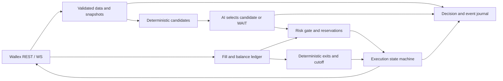

# Handoff به Agent معماری — Phase 01

تاریخ مبنا 2026-10-22؛ timezone انسانی Asia/Tehran، timestamp داده/ledger ترجیحاً UTC. **درخواست این فاز فقط تحقیق است. هیچ production code، معامله، تغییر حساب یا درخواست کلید انجام نشده. اجرای Phase 2 نیازمند درخواست آن فاز است.**

## تصمیم اصلی پیشنهادی

یک kernel کوچک Wallex، یک agent محدود، یک یا دو نماد TMN، spot-only بدون فروش استقراضی یا اهرم اضافه. اعتبار ۵میلیونی طرح را با مجوز معامله تعهدی یکی نگیرید. B0 قاعده‌مند برای benchmark؛ C1 breakout + LLM arbitration اولین آزمایش. C2 mean reversion مشروط، C3 selector روی دو candidate افزونه است. هنوز هیچ performance عددی تولید نشده.

از کدهای upstream کپی خام نکنید. اجزای الهام: Freqtrade protections/leakage، Hummingbot triple barrier، Nautilus risk/reconciliation، Condor bounded tools/journal. dependency کامل هیچ‌کدام انتخاب قطعی نشده است. [F01][F04][H01][N01][N03][C01][C03]

## Constraints غیرقابل مذاکره

- حساب اختصاصی واحد، پایه ارزیابی ۵٬۰۰۰٬۰۰۰ TMN، دوره سه روز؛ cutoff دقیق U01. سود خالص نسبی و تأیید فنی هر دو مهم. [B01]
- الگوریتم همه تصمیم‌ها/سفارش‌ها را انجام دهد؛ manual/self/wash/coordinated trading ممنوع. ساخت فعالیت مصنوعی برای امتیاز ممنوع. [B01]
- فقط allowlist طرح + محدودیت اضافی برگزارکننده؛ UNKNOWN symbol → no entry. [B01][W14]
- هدف پایان TMN-flat؛ تعارض بند mark-to-market/realized و dust هنوز تأیید داور می‌خواهد. [B01]
- AI اثر واقعی بر انتخاب/رد؛ ریسک override نمی‌شود. توضیح پس از تصمیم کافی نیست؛ معیار حداقلی پذیرش داور UNKNOWN.
- سورس دقیق اجراشده + config + decision logs + راهنمای replay در GitHub فاز تحویل، Demo حدود پنج دقیقه الزامی. نسخه اجرا/تحویل باید مطابق باشند. UI اولویت اصلی نیست. [B01]

جدول امتیاز Brief «پیشنهادی» است: سود۹۰، کنترل‌ضرر۳۰، فعالیت۱۵، پایداری۱۵؛ منطق۴۰، AI۳۵، ریسک۳۰، replay۲۵، تست۲۰. وزن‌های قطعی را تأیید کنید؛ optimize کردن یک عدد مبهم نادرست است.

## قابلیت‌های Wallex: چه چیز روشن شد؟

| نیاز | نتیجه تأییدشده | چیزی که باید هنوز بررسی شود |
|---|---|---|
| حساب اعتباری | هر subaccount کلید مستقل دارد؛ حدس header نزنید [W02] | کلید تیم واقعاً به همین حساب وصل است؛ اینجا کلید درخواست نکنید |
| طرح | `/v1/prop/packages/183` عمومی، ACTIVE، assurance=0، loan=5000000، expire_days=3 و fee صفر [P01] | UI هر دو را TMN نمایش می‌دهد؛ نحوه trigger عملی هنوز نامعلوم [W28] |
| universe | `is_spot` منهای unavailableMarkets؛ snapshot ۱۲۰ عضو؛ full table موجود [P01][P02] | وضعیت و سیاست نهایی برگزارکننده؛ refresh هنگام startup |
| تاریخچه | `/v1/udf/history` و OHLCV؛ نمونه ۱دقیقه تأیید شد [W03][P04] | resolution=15 در نمونه ۱دقیقه برگشت؛ retention/limits و timestamp semantics |
| book | REST `/v1/depth` و WS v2؛ هر سمت snapshot کامل [W11][W18][W19] | دو سمت coherent/تازه، reconnect؛ آرشیو تاریخی نداریم |
| order | POST `/v1/account/orders`؛ client_id یکتا؛ ۲۰ درخواست/۱۰ثانیه [W05] | MARKET price و stop_Price casing، account support، idempotency lifetime |
| lifecycle | GET order/detail/history/openOrders؛ fills با feeAsset؛ DELETE به client_id [W07][W08][W09][W10] | private fixtures، ordering/dedup رویداد و partial/cancel races |
| خروج | LIMIT/MARKET/STOP_* در docs [W06] | OCO/native trailing/credit stops UNKNOWN؛ Market-disabledها حذف اولیه |
| fee/balance | endpoint مستند است [W13][W25] | نرخ/available/locked واقعی حساب، scope و fee currency |
| MCP | endpoint رسمی `https://api.wallex.ir/mcp`، Streamable HTTP؛ server1.0.0؛ ۵۲ ابزار و خواندن عمومی طرح۱۸۳ مشاهده شد [W26][W27][P07][P08][P09] | private account/write آزموده نشده؛ quantity/enumها را از schema سست حدس نزنید؛ U04 اکنون تأیید/خودکاری write است |

برای اولین universe تحقیق، BTCTMN/ETHTMN از allowlist و Market flag عمومی عبور می‌کنند؛ همچنان spread/depth/خروج باید بررسی شوند. SOLTMN/XRPTMN/DOGETMN در snapshot Market-disabled بودند. هیچ نمادی صرفاً به دلیل حجم ۲۴ساعته یا نام مشهور انتخاب نشود. [P02][P03]

## قرارداد پیشنهادی ماژول‌ها

- **MarketSnapshot**: event/receive times، symbol، closed bars، bid/ask freshness، quality flags، metadata version.
- **SignalCandidate**: candidate_id، strategy/version، symbol، direction=BUY یا exit intent، feature references، expiry، estimated costs؛ stop/time policy ID.
- **AgentDecision**: snapshot_id، انتخاب یکی از candidate_idها یا WAIT، reason codes/evidence؛ مدل حق symbol/size/stop اختراعی ندارد.
- **RiskVerdict**: approve/reject و دلیل، qty قابل‌قبول با Decimal/precision، exposure reservation؛ قبل از submit دوباره validate.
- **ExecutionEvent/Ledger**: intent/clientOrderId، raw status، cumulative fills، net asset after fees، reserved/locked/available، reconciliation state. enum داخلی را با status رسمی یکی نگیرید.
- **RunManifest**: commit/config/data/prompt hash، model ID/settings، UTC clock، mode، seed، universe/limits، dependency versions.

ایده‌های معماری فوق PROPOSED هستند. Risk path مستقل از دسترسی مدل است؛ exit watcher در outage مدل متوقف نشود. یک coordinator مانع own-cross و فروش مضاعف SL/TP شود. [N01][C01][H02]

## اولویت کار و gateهای Phase 2

| ترتیب | کار | خروجی قابل بررسی / شرط عبور |
|---|---|---|
| ۰ | بررسی منابع رسمی برای U01/U02/U04؛ ثبت budget زمان و ریسک | برای ادامه تحقیق اطلاعات تازه از صاحب پروژه نخواهید؛ cutoff/تسویه/private blockers قبل live لازم‌اند؛ MCP عمومی اکنون قابل بررسی است |
| ۱ | data/account read-only spike | fixture بی‌secret؛ coverage و timestamp QC؛ account scope/fees/precision مطابق حساب؛ بدون فرض resolution |
| ۲ | baseline C1 با backtest محدود | temporal split قفل‌شده، fee/slippage/latency stress، همه trialها و baseline cash/buy-hold-liquidated |
| ۳ | kernel ریسک و شبیه‌ساز اجرا | sizing/reservation، partial fill فوری، UNKNOWN reconciliation، restart، kill latch، cutoff liquidation |
| ۴ | AI arbitration + ablation | تصمیم مدل واقعاً تغییر ایجاد کند؛ schema/TTL/WAIT policy و ثبت prompt/output؛ benchmark latency |
| ۵ | Shadow و failure fixtures | صفر write واقعی، صفر duplicate/overspend، پاسخ مشخص به خطاها و پایان دوره؛ گزارش محدودیت fill |
| ۶ | تصمیم معماری نهایی و تحویل | C2/C3 فقط با شواهد/زمان؛ README اجرا و replay، نسخه ثابت، logs، طرح Demo |

این جدول اجازه live نیست. درخواست جاری کدنویسی محصول را منع کرده است؛ شروع implementation با دستور Phase 2 باشد. آستانه زیان و بودجه execution باید با صاحب پروژه و evidence تعیین شوند، نه با defaults مرجع.

اگر کمتر از یک روز توسعه مانده، C2/C3/ML/داشبورد پیچیده را حذف کنید. زمان تست/تحویل را فدای افزایش strategy نکنید. اگر data یا private capability کافی نبود، mode معتبر research/shadow را گزارش کنید و ادعای live-ready نسازید.

## Rejected / deferred

- LLM با دسترسی raw order، انتخاب حجم آزاد یا override ریسک؛ چندagent که مستقل روی یک حساب سفارش می‌گذارند.
- RL/FinRL training یا fine-tune؛ dataset و simulator معتبر نداریم. [L01]
- OBI alpha، market making/grid و arbitrage؛ book تاریخی/queue/atomic execution احراز نشده.
- مارتینگل، ورود تمام‌سرمایه، manual trade برای رفع کم‌فعالیتی.
- افزودن indicator یا sweep هزاران پارامتر؛ ۲ خانواده و بودجه trial ثبت‌شده کافی برای شروع. [A03]
- dependency کامل بات برای دورزدن نوشتن adapter؛ در treeهای snapshot Wallex پیدا نشد.
- vectorbt به‌عنوان Apache خالص؛ نسخه حاضر Commons Clause دارد؛ GPL/AGPL/LGPL را بدون تصمیم مجوز وارد ترکیب نکنید. [R08][R02][R09][R03]

## تصمیم‌های باز

۱. final universe و quote پایه: پیشنهاد TMN برای کم‌کردن تبدیل نهایی؛ انتخاب نهایی بعد از نقدینگی/هزینه.
۲. بازه strategy و پنجره‌ها: از ۱دقیقه تأییدشده aggregate؛ ۵/۱۵دقیقه صرفاً candidate آزمایش.
۳. stop بومی یا local: وابسته به reserve semantics و امکان exit؛ local stop بدون watcher پایدار کافی نیست.
۴. fee/stress/slippage/TTL و loss/exposure budgets: نیازمند داده و تصمیم تیم؛ اعداد منبع کپی نشوند.
۵. مدل/زبان/hosting: دسترسی، budget و latency تیم مشخص نیست؛ Python با سابقه این اکوسیستم قابل بررسی است، تصمیم قطعی نیست.
۶. prompt freeze، سیاست fallback و replay: WAIT ورود جدید هنگام خطای AI، خروج deterministic؛ پاسخ‌های ذخیره‌شده برای replay.
۷. ابزار backtest: kernel سبک یا dependency محدود با مجوز سازگار؛ full framework تعهد زمانی دارد.

مشخصات MCP را ابتدا از `WALLEX_MCP_REVIEW_FA.md` و schema ذخیره‌شده بخوانید. برای ابزارهای read، candle/depth/fees/orders/credit موجودند؛ secret فقط در هدر و با کلید حساب هدف، هرگز آرگومان ابزار نیست. به مدل همه ۵۲ ابزار خصوصاً margin/transfer/account change داده نشود. فهرست کامل U01–U11 و اثر هر blocker در `WALLEX_CHALLENGE_AND_CAPABILITIES_FA.md` است.

## منابعی که MUST READ هستند

- صفحه رسمی MCP و راهنمای canonical و schema مشاهده‌شده [W26][W27][P08]؛ metadata با اجرای خصوصی برابر نیست.
- Brief کامل [B01]؛ به‌خصوص realized TMN، بارم پیشنهادی، log و همان‌بودن نسخه سورس.
- ساخت کلید حساب مستقل [W02]، فهرست طرح [W14] و پاسخ رسمی طرح ۱۸۳ [P01].
- ثبت سفارش/انواع/جزئیات و cancel [W05][W06][W07][W08]؛ assumptions اجرای Wallex را از exchange دیگر منتقل نکنید.
- migration و snapshot depth [W18][W19]؛ دو پاسخ resolution یکسان‌بازه [P04][P05].
- Freqtrade backtest assumptions و leakage [F03][F04]؛ Hummingbot PositionExecutor به‌خصوص partial/Market assumptions [H02].
- Nautilus reconciliation [N03] و Condor risk gate/tests [C01][C04]؛ از معماری ایده بگیرید، مجوز فایل را رعایت کنید.

هر source با URL، عنوان و تاریخ دسترسی در `SOURCE_MATRIX.md` است. `evidence/` پاسخ‌های رسمی محدود، متن Brief و snapshot نسخه/مجوزها را نگه می‌دارد. این pack از نتایج تبلیغاتی README به‌عنوان شاهد سود استفاده نکرده است.

## ارجاع‌ها

[A03]: https://escholarship.org/uc/item/4w1110bb "The Probability of Backtest Overfitting — Bailey et al.؛ دسترسی 2026-10-22"
[B01]: evidence/BRIEF_PROVIDED_FA.md "Brief رسمی ارائه‌شده توسط صاحب پروژه؛ دسترسی 2026-10-22"
[C01]: https://github.com/hummingbot/condor/blob/8e4860fa3d7efd4b55c2b74dd7f1f439e5a4f32c/condor/agents/risk.py "Agent risk gate؛ دسترسی 2026-10-22"
[C03]: https://github.com/hummingbot/condor/blob/8e4860fa3d7efd4b55c2b74dd7f1f439e5a4f32c/condor/agents/journal.py "JournalManager؛ دسترسی 2026-10-22"
[C04]: https://github.com/hummingbot/condor/blob/8e4860fa3d7efd4b55c2b74dd7f1f439e5a4f32c/tests/test_risk_gate.py "Risk gate tests؛ دسترسی 2026-10-22"
[F01]: https://github.com/freqtrade/freqtrade/blob/c051e9065c5b677f03817dd1f83cb980af1ed684/freqtrade/plugins/protections/max_drawdown_protection.py "Drawdown protection؛ دسترسی 2026-10-22"
[F03]: https://github.com/freqtrade/freqtrade/blob/c051e9065c5b677f03817dd1f83cb980af1ed684/docs/backtesting.md "Backtesting assumptions؛ دسترسی 2026-10-22"
[F04]: https://github.com/freqtrade/freqtrade/blob/c051e9065c5b677f03817dd1f83cb980af1ed684/docs/lookahead-analysis.md "Lookahead analysis؛ دسترسی 2026-10-22"
[H01]: https://github.com/hummingbot/hummingbot/blob/9af100d6822da7d2d0291a906c730ef172284ee2/hummingbot/strategy_v2/executors/position_executor/data_types.py "TripleBarrierConfig؛ دسترسی 2026-10-22"
[H02]: https://github.com/hummingbot/hummingbot/blob/9af100d6822da7d2d0291a906c730ef172284ee2/hummingbot/strategy_v2/executors/position_executor/position_executor.py "PositionExecutor؛ دسترسی 2026-10-22"
[L01]: https://github.com/AI4Finance-Foundation/FinRL/blob/c0018c25de864157dc8470f0047b0d10ec721715/finrl/meta/env_cryptocurrency_trading/env_multiple_crypto.py "CryptoEnv؛ دسترسی 2026-10-22"
[N01]: https://github.com/nautechsystems/nautilus_trader/blob/9156e8f2d7126236269b6fcd2e6402b7a8e4e6d8/crates/risk/src/engine/mod.rs "RiskEngine؛ دسترسی 2026-10-22"
[N03]: https://github.com/nautechsystems/nautilus_trader/blob/9156e8f2d7126236269b6fcd2e6402b7a8e4e6d8/docs/concepts/execution/reconciliation.md "Reconciliation؛ دسترسی 2026-10-22"
[P01]: https://api.wallex.ir/v1/prop/packages/183 "طرح ۱۸۳: پاسخ عمومی واقعی؛ دسترسی 2026-10-22"
[P02]: https://api.wallex.ir/hector/web/v1/markets "مارکت‌های اسپات: پاسخ عمومی واقعی؛ دسترسی 2026-10-22"
[P03]: https://api.wallex.ir/v1/markets "Metadata بازارها: پاسخ عمومی واقعی؛ دسترسی 2026-10-22"
[P04]: https://api.wallex.ir/v1/udf/history?symbol=BTCTMN&resolution=1&from=1792566950&to=1792653350 "تاریخچه ۱دقیقه BTCTMN: پاسخ واقعی؛ دسترسی 2026-10-22"
[P05]: https://api.wallex.ir/v1/udf/history?symbol=BTCTMN&resolution=15&from=1792566950&to=1792653350 "تاریخچه با resolution=15: پاسخ واقعی؛ دسترسی 2026-10-22"
[R02]: https://github.com/freqtrade/freqtrade/tree/c051e9065c5b677f03817dd1f83cb980af1ed684 "freqtrade/freqtrade؛ دسترسی 2026-10-22"
[R03]: https://github.com/nautechsystems/nautilus_trader/tree/9156e8f2d7126236269b6fcd2e6402b7a8e4e6d8 "nautechsystems/nautilus_trader؛ دسترسی 2026-10-22"
[R08]: https://github.com/polakowo/vectorbt/tree/dd8eb3a3fe9ed918b1cdaf177455759ae4ac68cb "polakowo/vectorbt؛ دسترسی 2026-10-22"
[R09]: https://github.com/kernc/backtesting.py/tree/ca2e2611621e472542ba90f7243a1fa06a7d7108 "kernc/backtesting.py؛ دسترسی 2026-10-22"
[W02]: https://developers.wallex.ir/docs/create-api-key "ساخت API-Key — Wallex API Documentation؛ دسترسی 2026-10-22"
[W03]: https://developers.wallex.ir/docs/basic-services-candles "کندل‌ها — Wallex API Documentation؛ دسترسی 2026-10-22"
[W05]: https://developers.wallex.ir/docs/spot-create-order "ثبت سفارش اسپات — Wallex API Documentation؛ دسترسی 2026-10-22"
[W06]: https://developers.wallex.ir/docs/spot-types "انواع سفارش اسپات — Wallex API Documentation؛ دسترسی 2026-10-22"
[W07]: https://developers.wallex.ir/docs/spot-cancel-order "لغو سفارش — Wallex API Documentation؛ دسترسی 2026-10-22"
[W08]: https://developers.wallex.ir/docs/spot-single-order-detail "جزئیات سفارش — Wallex API Documentation؛ دسترسی 2026-10-22"
[W09]: https://developers.wallex.ir/docs/spot-order-list "لیست سفارش‌ها — Wallex API Documentation؛ دسترسی 2026-10-22"
[W10]: https://developers.wallex.ir/docs/spot-active-orders "سفارش‌های فعال — Wallex API Documentation؛ دسترسی 2026-10-22"
[W11]: https://developers.wallex.ir/docs/basic-services-depth "عمق بازار — Wallex API Documentation؛ دسترسی 2026-10-22"
[W13]: https://developers.wallex.ir/docs/basic-services-account-fee "کارمزد حساب — Wallex API Documentation؛ دسترسی 2026-10-22"
[W14]: https://developers.wallex.ir/docs/trade-credit-package-details "جزئیات طرح و بازارهای غیرفعال — Wallex API Documentation؛ دسترسی 2026-10-22"
[W18]: https://developers.wallex.ir/docs/socket-migration "راهنمای مهاجرت وب‌سوکت — Wallex API Documentation؛ دسترسی 2026-10-22"
[W19]: https://developers.wallex.ir/docs/socket-buy-depth "عمق خرید وب‌سوکت — Wallex API Documentation؛ دسترسی 2026-10-22"
[W25]: https://developers.wallex.ir/docs/generated/sub-account-balances-details "Sub Account Balances Details — Wallex API Documentation؛ دسترسی 2026-10-22"
[X01]: https://github.com/mhsenpc/wallex_mcp_server "mhsenpc/wallex_mcp_server؛ دسترسی 2026-10-22"

[P07]: https://api.wallex.ir/mcp "MCP initialize response — Wallex official server؛ دسترسی 2026-10-22"
[P08]: https://api.wallex.ir/mcp "MCP tools/list — 52 advertised tools؛ دسترسی 2026-10-22"
[P09]: https://api.wallex.ir/mcp "MCP public package details — package 183؛ دسترسی 2026-10-22"
[W26]: https://wallex.ir/landing/mcp/ "MCP والکس — صفحه رسمی اتصال؛ دسترسی 2026-10-22"
[W27]: https://api.wallex.ir/llm.txt "Wallex canonical sources and MCP access rules؛ دسترسی 2026-10-22"
[W28]: https://wallex.ir/app/trade-credit/prop/183 "هکاتون استارکوچ | والکس — صفحه رسمی طرح ۱۸۳؛ دسترسی 2026-10-22"
